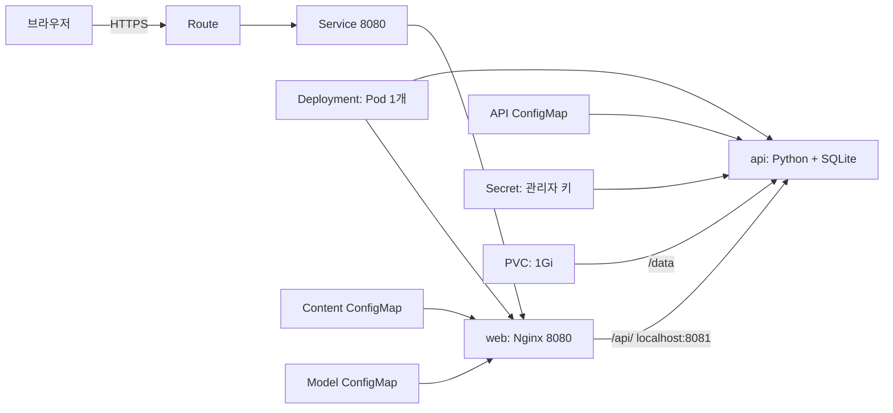
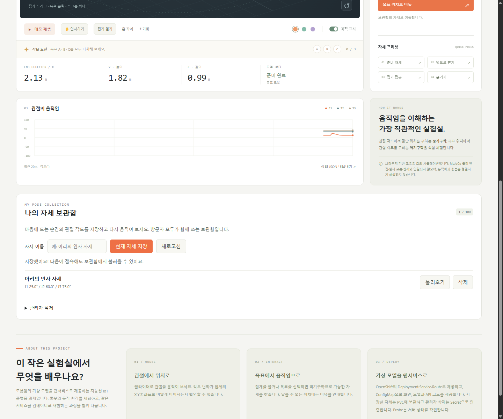
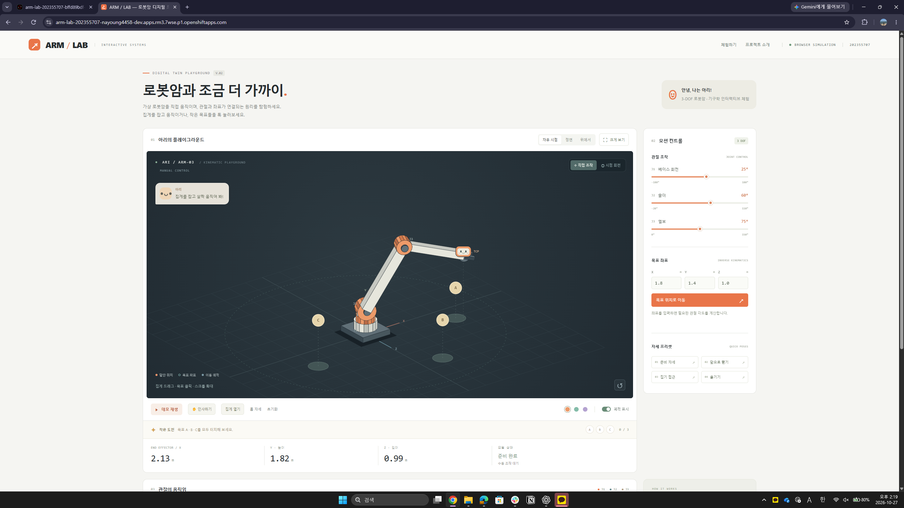
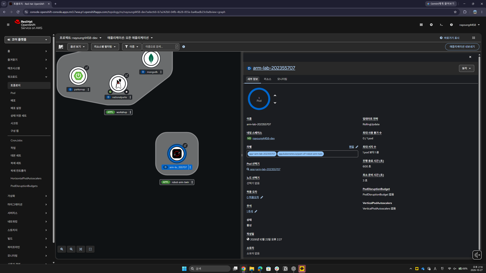
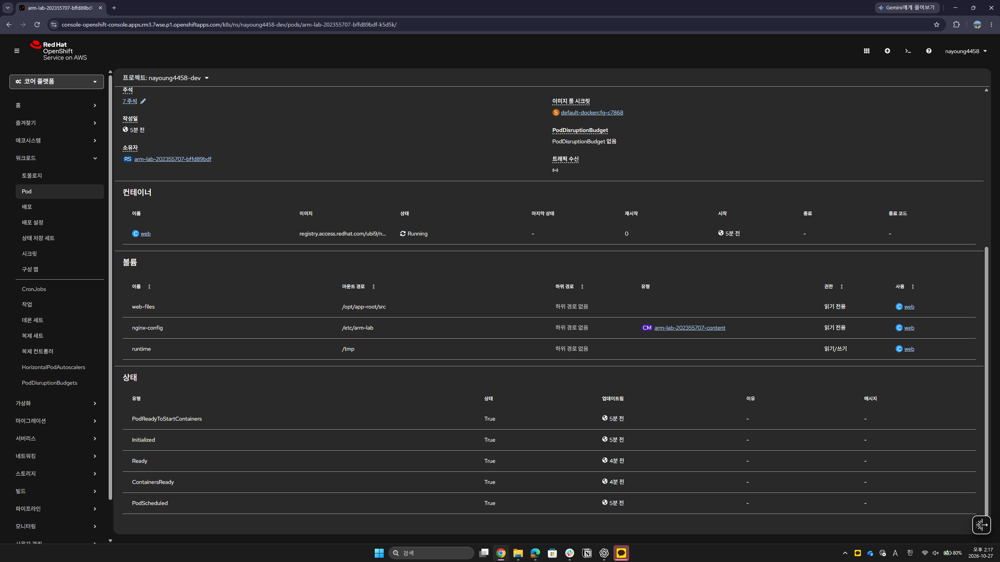
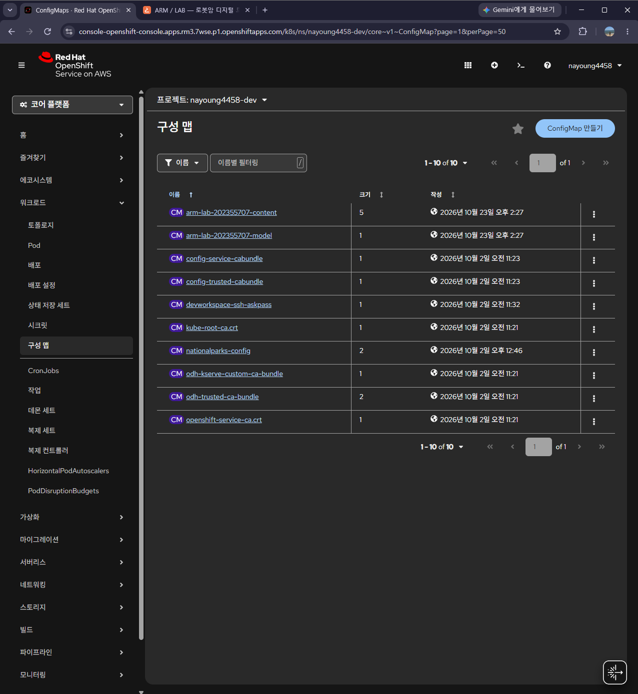
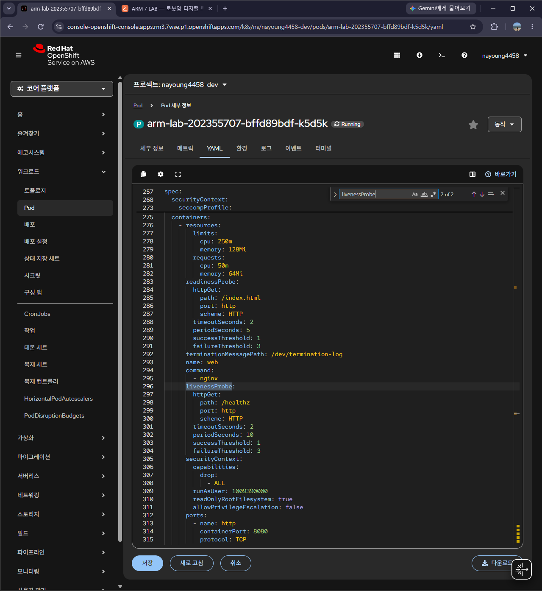
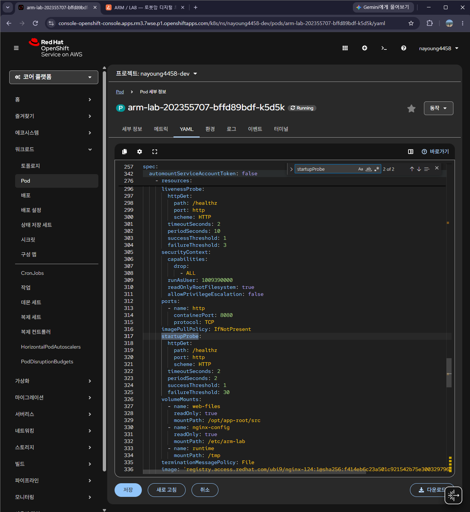
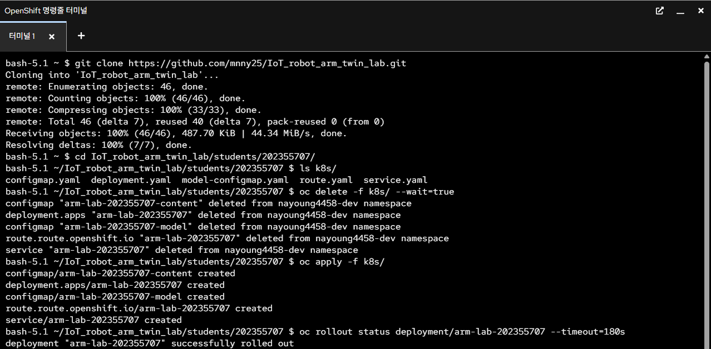
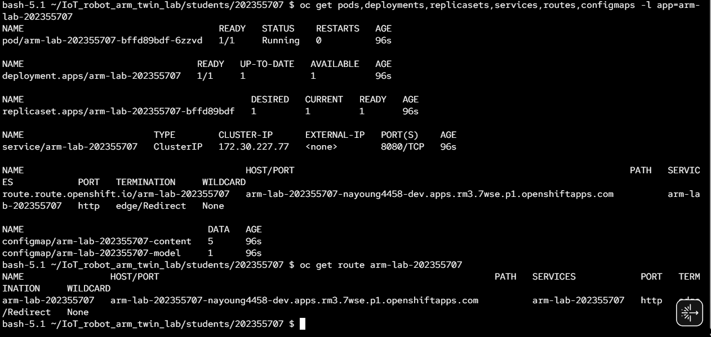

# ARM / LAB - 로봇암 디지털 트윈 체험 웹서비스

**학번 202355707 / 지능형 IoT 플랫폼 / 나만의 컨테이너 만들기**

> V.03은 자세 저장과 불러오기, 관리자 삭제 기능을 추가한 버전입니다. 로컬 HTTP 테스트와 YAML 정적 검사를 수행했습니다. OpenShift에서 새 버전의 배포, PVC 데이터 유지와 Secret 인증 결과는 직접 확인 후 아래 체크리스트에 기록해야 합니다. 기존 캡처는 V.02 배포 기록입니다.

## 1. 컨테이너 소개

ARM / LAB은 가상 로봇암의 관절과 목표 위치를 직접 조작하며 움직임의 원리를 배우는 웹서비스입니다. 로봇암과 MuJoCo 시뮬레이션에 관심이 있어 이 주제를 골랐습니다. 별도 설치 없이 브라우저에서 기구학을 체험하고, 마음에 드는 자세를 보관함에 저장할 수 있습니다.

자체 JavaScript 모델을 사용한 교육용 체험입니다. 실제 로봇이나 센서와 동기화하지 않으며 MuJoCo 물리 엔진, 중력, 관성, 물체 집기나 정밀 충돌 해석은 포함하지 않습니다.

| 기능 | 동작 |
| --- | --- |
| 관절 조작 | J1 베이스, J2 숄더, J3 엘보 각도에 따라 로봇암과 말단 X/Y/Z 좌표 갱신 |
| 목표 이동 | 좌표 입력, 집게 드래그와 바닥 클릭으로 역기구학 해 계산. 불가능한 자세나 경로 안내 |
| 체험 도구 | A, B, C 도전, 자세 프리셋, 반복 데모, 인사, 시점 조작, 궤적과 최근 20초 그래프 |
| 자세 보관함 | 현재 관절 각도와 이름 저장, 목록 조회와 불러오기. 방문자가 공유하는 최대 100개 보관함 |
| 관리자 삭제 | 올바른 관리자 키를 전송한 경우에만 서버에서 자세 삭제 |

### 모델 범위

- Y축이 높이인 3 DOF 모델입니다. 단위는 거리 m, 각도 °입니다.
- 기본 길이는 베이스 0.65 m, 상완 1.8 m, 전완 1.5 m이며 모델 ConfigMap으로 제공합니다.
- J1은 -180°~180°, J2는 -20°~110°, J3는 0°~150°입니다. 엘보와 말단 중심의 바닥 여유 높이는 0.15 m 이상입니다.
- 목표 이동은 smoothstep 보간과 경로의 61개 지점 검사를 사용합니다. 역기구학은 한 가지 굽힘 해를 계산합니다.
- 집게 드래그는 카메라를 향하는 수직 평면을 사용합니다. 바닥 클릭은 X/Z와 입력창의 Y 높이를 사용합니다.
- 집게와 표정은 시각 표현입니다. 목표 완료 기준은 말단과 목표 사이 거리 0.08 m 미만입니다.
- 실시간 조작 상태는 브라우저 메모리에 있고, 사용자가 저장한 이름과 관절 각도만 서버 SQLite에 기록합니다. 사용자별 계정이나 보관함 분리는 구현하지 않았습니다.

## 2. 아키텍처와 추가 Object



하나의 Pod에 web과 api 컨테이너를 둡니다. Nginx는 정적 파일을 제공하고 `/api/` 요청을 같은 Pod의 API로 전달합니다. 브라우저가 기구학 계산과 그리기를 담당하고, Python API는 SQLite 저장과 삭제 인증을 담당합니다. Service는 Nginx의 8080 포트만 노출합니다.

| Object 또는 설정 | 이름 | 역할과 확인 방법 |
| --- | --- | --- |
| Deployment | `arm-lab-202355707` | Pod 1개, 컨테이너 2개 유지. 정상 상태 `2/2 Running` |
| Service / Route | `arm-lab-202355707` | app 라벨로 Pod를 선택하고 HTTPS 접속 제공 |
| Content ConfigMap | `arm-lab-202355707-content` | HTML, CSS, JavaScript와 Nginx 설정 주입 |
| Model ConfigMap | `arm-lab-202355707-model` | 링크 길이, 속도와 프리셋 제공. 값 변경 전후 동작 비교 |
| API ConfigMap | `arm-lab-202355707-api` | 표준 라이브러리로 작성한 서버 코드를 읽기 전용으로 마운트 |
| Secret | `arm-lab-202355707-admin` | 관리자 키를 API에만 마운트. 잘못된 키는 HTTP 401, 올바른 키로 삭제하면 HTTP 200 |
| PVC | `arm-lab-202355707-poses` | ReadWriteOnce, 1Gi. `/data/poses.sqlite3` 보관. Pod 교체 후 자세 유지 확인 |
| Probe | 두 컨테이너의 Startup / Readiness / Liveness | 기동, 준비 상태와 생존 상태 검사. 별도 API Object가 아닌 컨테이너 설정 |
| emptyDir | `runtime` | Nginx의 `/tmp` 임시 파일. 영구 저장은 PVC가 담당 |

### 연결과 운영 설정

- Route의 대상과 Service 이름이 같고, Service의 `targetPort: http`는 web의 `containerPort: 8080`과 연결됩니다.
- API는 8081에서 동작하며 Secret은 웹 루트에 노출하지 않습니다. 삭제 요청마다 마운트된 키 파일을 읽습니다.
- web과 api 각각 requests는 CPU 50m / 메모리 64Mi, limits는 CPU 250m / 메모리 128Mi입니다. Pod 합계 requests는 100m / 128Mi, limits는 500m / 256Mi입니다.
- 고정 UID 없이 비루트 실행, 권한 상승 금지, capability 제거, RuntimeDefault seccomp와 읽기 전용 루트를 적용했습니다. PVC 권한은 OpenShift의 SCC와 볼륨 권한 할당에 따릅니다.
- SQLite와 RWO PVC는 단일 Pod로 사용합니다. 업데이트 전략은 `Recreate`이며 기존 Pod 종료 후 새 Pod가 시작되므로 교체 중 짧은 접속 중단이 있습니다.
- 기본 StorageClass를 사용하므로 해당 클러스터에 동적 스토리지와 1Gi 이상의 가용 할당량이 필요합니다.
- 제출 YAML에 namespace, Route host, UID, resourceVersion, status 같은 자동 생성 값은 넣지 않았습니다.

**관리자 키는 과제 재현을 위한 공개 데모 값 `arm-lab-demo-202355707`입니다. 실제 서비스용 비밀 정보가 아닙니다.** 운영 시에는 별도 비공개 키로 Secret을 교체해야 합니다. 저장과 조회는 공개되며 관리자 키는 삭제에만 사용합니다.

## 3. 사용 이미지

| 컨테이너 | 공개 이미지 | 포트 / 실행 |
| --- | --- | --- |
| web | `registry.access.redhat.com/ubi9/nginx-124:1` | 8080 / `nginx -c /etc/arm-lab/nginx.conf -g 'daemon off;'` |
| api | `registry.access.redhat.com/ubi9/python-312:1` | 8081 / `python3 -B /opt/arm-lab/server.py` |

Deployment에 두 이미지의 digest를 고정했습니다. Nginx는 2026-10-23, Python은 2026-10-27 Red Hat 레지스트리에서 manifest digest를 확인했습니다. Python API는 추가 패키지를 설치하지 않습니다. 실제 컨테이너 실행과 PVC 마운트 확인은 V.03 OpenShift 배포에서 수행해야 합니다.

## 4. 저장소 구조와 배포 방법

```text
students/202355707/
├── README.md
├── k8s/                  # 채점용 YAML 8개
│   ├── configmap.yaml
│   ├── model-configmap.yaml
│   ├── api-configmap.yaml
│   ├── deployment.yaml
│   ├── service.yaml
│   ├── route.yaml
│   ├── secret.yaml
│   └── pvc.yaml
├── web/                  # 화면과 모델 설정
├── backend/server.py     # 저장, 조회와 인증 삭제 API
├── tools/                # 생성, 정적 검사, API 테스트와 로컬 실행
├── docs/objects-v03.md   # 새 버전 배포 및 추가 Object 검증
└── images/               # 기존 배포 증빙과 새 캡처
```

본인 Sandbox에 로그인하고 `students/202355707`에서 실행합니다. 웹 터미널은 로그인된 계정과 프로젝트를 먼저 확인합니다.

```bash
oc whoami
oc project
oc apply -f k8s/
oc rollout status deployment/arm-lab-202355707 --timeout=300s
oc get pods,deployments,services,routes,configmaps,secrets,pvc -l app=arm-lab-202355707
oc get route arm-lab-202355707 -o jsonpath='{.spec.host}'
```

PVC `Bound`, Pod `2/2 Running`을 확인한 뒤 Route host에 `https://`를 붙여 접속합니다. 예상 화면은 V.03 로봇암 체험과 ‘나의 자세 보관함’입니다. 관절 조작, 데모, 자세 저장과 불러오기를 확인합니다. `/healthz`는 HTTP 200과 `ok`, `/api/health`는 HTTP 200과 `{"status":"ok"}`, `/api/poses`는 `{"poses":[...]}`를 반환합니다.

웹 파일과 API 코드가 ConfigMap에 포함되어 있어, 다른 사람도 이미지 빌드나 원본 복사 없이 YAML만으로 배포할 수 있습니다. 기존 V.02 배포에 적용할 때도 위 `oc apply`를 사용합니다.

### 원본 수정과 로컬 검사

```bash
python tools/sync-configmap.py
python tools/verify-manifests.py
python tools/test-api.py
python tools/run-local.py
```

로컬 통합 화면은 <http://127.0.0.1:8765>입니다. SQLite와 데모 키는 Git에서 제외한 `.local/`에 저장됩니다. 로컬 테스트는 Kubernetes PVC 자체를 검증하는 것이 아닙니다. 수정 후 생성된 YAML과 원본을 함께 Commit하고 `oc apply -f k8s/`로 반영합니다.

### 삭제 후 YAML만으로 재배포

**아래 명령은 PVC도 삭제하므로 저장한 자세가 사라질 수 있습니다.** 데이터 유지 시험에서는 PVC를 남겨두고 Pod만 교체합니다. 전체 삭제 시험은 과제 재현성 확인용으로 따로 수행합니다.

```bash
oc delete -f k8s/ --wait=true
oc apply -f k8s/
oc rollout status deployment/arm-lab-202355707 --timeout=300s
oc get pods,deployments,services,routes,configmaps,secrets,pvc -l app=arm-lab-202355707
oc get route arm-lab-202355707
```

새로 조회한 Route에 접속하여 저장, 불러오기, 관리자 삭제와 기존 데모를 확인합니다. `oc get all`이 Sandbox의 다른 API 조회 권한 때문에 Forbidden을 반환하면 위처럼 리소스 종류를 명시합니다.

## 5. 배포 결과와 검증

| V.03 검증 | 현재 상태 |
| --- | --- |
| YAML 8개, 참조와 체크섬 정적 검사 | 로컬 통과 |
| 저장, 목록 조회, 인증 거부와 성공, 키 교체 | 로컬 HTTP 테스트 통과 |
| 브라우저 저장, 불러오기, 인증 삭제와 모바일 레이아웃 | 로컬 Chrome에서 확인, JavaScript 예외 없음 |
| 같은 DB로 API 재시작 후 자세 유지 | 로컬 테스트 통과. 실제 PVC 유지 시험은 별도 필요 |
| 잘못된 입력, 동시 저장, 최대 100개 제한 | 로컬 테스트 통과 |
| OpenShift의 새 이미지 실행, PVC Bound, Pod 2/2 Running | 배포 후 확인 필요 |
| 실제 Route에서 저장과 불러오기, Secret 인증 | 배포 후 확인 필요 |
| Pod 교체 후 PVC 데이터 유지 | 배포 후 확인 필요 |
| YAML 8개 전체 삭제 후 재배포 | 배포 후 확인 필요 |



위 이미지는 로컬 미리보기이며 실제 OpenShift 배포 증빙은 아닙니다.

실험 순서와 캡처 목록은 [V.03 검증 가이드](docs/objects-v03.md)에 정리했습니다. 새 캡처는 `images/`에 추가하고 본문에 삽입합니다. 설정 화면만으로 Secret 인증이나 PVC 데이터 유지가 검증되었다고 기록하지 않습니다.

기존 Route: [ARM / LAB 웹서비스](https://arm-lab-202355707-nayoung4458-dev.apps.rm3.7wse.p1.openshiftapps.com). V.03 적용 전에는 V.02 화면일 수 있으며 재배포 후 실제 주소를 확인합니다. Sandbox 정책으로 Pod가 0개가 된 경우 Deployment를 1개로 확장하고 준비 상태를 확인합니다.

<details>
<summary>이전 V.02 배포와 재배포 증빙 (2026-10-27)</summary>

다음은 Secret과 PVC를 추가하기 전 기록입니다. Pod 1/1, ConfigMap 2개와 RollingUpdate 화면은 당시 구성입니다. V.03 검증 결과를 대신하지 않습니다.

- **확인 일시:** 2026-10-27 14:13~14:48 (Asia/Seoul)
- **환경:** Red Hat Developer Sandbox / OpenShift, 프로젝트 `nayoung4458-dev`
- **실제 접속 주소:** [ARM / LAB 웹서비스](https://arm-lab-202355707-nayoung4458-dev.apps.rm3.7wse.p1.openshiftapps.com)
- **확인 범위:** V.02 실제 페이지 표시, 컨테이너 Running / Ready=True, Service와 Route 연결, ConfigMap 두 개와 Startup, Readiness, Liveness 설정. 정지 영상이므로 모든 인터랙션 실행이나 장애 복구 실험까지 증명하는 것은 아닙니다.

| 검증 항목 | 확인 결과 | 증빙 |
| --- | --- | --- |
| 실제 웹서비스 | Route 주소에서 V.02 플레이그라운드와 프로젝트 설명 표시 | 아래 웹페이지 캡처 |
| Deployment, Service, Route | Pod 1개, RollingUpdate, Service와 HTTPS Route 연결 | Topology와 Deployment 캡처 |
| Pod와 볼륨 | 컨테이너 Running, 재시작 0회, Ready=True. 웹 파일과 Nginx 설정 읽기 전용 마운트와 /tmp 쓰기 공간 | Pod 상태와 볼륨 캡처 |
| ConfigMap | content와 model 두 리소스 존재 | ConfigMap 목록 캡처 |
| Probe와 자원 제한 | /index.html Readiness, /healthz Liveness와 Startup, CPU와 메모리 requests/limits | Probe 캡처 2장 |
| 로컬 기능 및 정적 YAML | 기존 브라우저 기능 검증과 YAML 연결, 파일, 체크섬 검사 통과 | 로컬 미리보기와 `tools/verify-manifests.py` |
| 삭제 후 재배포 | YAML 5개 삭제 후 재생성, successfully rolled out, Pod 1/1 Running, 재시작 0회 확인 | 아래 재배포 과정과 상태 조회 캡처 |
| 재배포 후 브라우저 기능 | 추가 확인 필요 | 실제 Route에서 관절 조작과 데모 재확인 후 기록 |
| 모델 설정 변경 비교 | 추가 검증 필요 | 수행 후 변경 값과 전후 결과 추가 |

### 실제 웹서비스 실행 화면

주소창과 V.02 체험 화면을 함께 확인할 수 있습니다.



### OpenShift 배포와 연결


<details>
<summary>Deployment의 Pod 수와 업데이트 정책</summary>



</details>

### Pod 정상 상태와 볼륨



### 추가 Object: 두 ConfigMap



목록 캡처는 두 ConfigMap의 존재를 보여줍니다. 모델 설정을 바꿔 동작이 달라지는 비교 실험은 별도로 기록합니다.

### Probe와 YAML 설정

<details>
<summary>Readiness / Liveness, CPU와 메모리, 보안 설정</summary>



</details>

<details>
<summary>Startup Probe와 마운트 및 비루트 보안 설정</summary>



</details>

위 화면은 OpenShift가 생성한 실제 Pod의 설정입니다. 서버가 할당한 UID나 자동 생성 값은 실행 화면에 보일 수 있지만 제출용 YAML에는 복사하지 않습니다.

Sandbox는 사용 시간 정책에 따라 Pod가 0개로 축소될 수 있습니다. 그 경우 Deployment를 1개로 확장하고 Ready 상태가 된 뒤 접속합니다. 이 주소는 촬영 시 확인한 배포 결과이며 항상 실행 중임을 보장하는 주소는 아닙니다.

### 삭제 후 YAML만으로 재배포

2026-10-27 웹 터미널에서 GitHub 저장소를 Clone하고 학번 폴더의 YAML만으로 다음 순서를 수행했습니다.

```bash
oc delete -f k8s/ --wait=true
oc apply -f k8s/
oc rollout status deployment/arm-lab-202355707 --timeout=180s
oc get pods,deployments,replicasets,services,routes,configmaps -l app=arm-lab-202355707
oc get route arm-lab-202355707
```

삭제된 리소스 5개가 다시 생성되고 `successfully rolled out`이 출력됐습니다. 재배포 후 Pod `arm-lab-202355707-bffd89bdf-6zzvd`는 **1/1 Running, 재시작 0회**였으며 Deployment와 ReplicaSet도 준비된 인스턴스 1개를 표시했습니다. Service 8080/TCP, HTTPS edge/Redirect Route, 두 ConfigMap이 다시 생성된 것을 확인했습니다.





`oc get all`은 이 Sandbox에서 권한이 없는 `applications.app.k8s.io`까지 조회해 Forbidden을 반환했습니다. 위처럼 과제 리소스 종류를 명시하여 조회했을 때 정상 출력됐습니다. 이는 추가 리소스 조회 권한 문제였으며 과제 리소스의 생성과 롤아웃은 성공했습니다.

두 캡처는 리소스 재생성과 정상 실행 상태를 증빙합니다. 재배포 이후의 브라우저 조작과 데모 재확인 결과는 확인 후 추가합니다.

<details>
<summary>로컬 화면 미리보기 - 실제 배포 캡처와 구분</summary>


</details>

</details>

## 6. 설계 과정과 확인할 점

| 문제 | 적용한 방법 | 검증 |
| --- | --- | --- |
| 새 Pod에서 저장한 자세를 다시 읽어야 함 | SQLite 파일을 PVC의 /data에 저장 | 로컬 API 재시작 통과, 실제 Pod 교체 시험 필요 |
| 공개 저장 기능과 관리자 삭제 구분 | Secret 파일과 Bearer 인증, hmac.compare_digest로 키 비교 | 인증 실패와 성공, 키 교체 로컬 통과 |
| RWO 볼륨을 사용하는 Pod 업데이트 | replicas 1 및 Recreate | 실제 클러스터 교체 확인 필요 |
| YAML만으로 코드까지 재현 | ConfigMap 3개에 모든 소스 포함, 체크섬으로 Pod 교체 | 정적 참조 검사 통과 |
| 기존 로봇암 체험과 저장 UI 연결 | 현재 각도 복사, 불러올 때 기존 경로 검사 사용 | 기존 바닥 및 관절 범위 검사를 유지 |

## 7. AI 및 참고자료 활용 내역

- **OpenAI Codex:** 주제 구체화, 웹 UI, 기구학 코드, YAML, 문서 초안 작성과 로컬 검증에 활용했습니다.
- **과제 안내 PDF:** README 필수 항목, 학번 폴더, YAML 재배포 및 채점 기준을 참고했습니다.
- **4-1, 4-2, 5-2 강의:** Deployment, Service와 Route 연결, OpenShift 배포, 자원 제한, Probe, ConfigMap을 참고했습니다.
- [Red Hat UBI Nginx 이미지](https://catalog.redhat.com/en/software/containers/ubi9/nginx-124/657b066b6c1bc124a1d7ff39) / [이미지 공식 사용 설명](https://github.com/sclorg/nginx-container/blob/master/1.24/README.md)
- [OpenShift 비루트 실행](https://developers.redhat.com/blog/2020/10/26/adapting-docker-and-kubernetes-containers-to-run-on-red-hat-openshift-container-platform)
- [Kubernetes projected volume](https://kubernetes.io/docs/concepts/storage/projected-volumes/) / [Probe](https://kubernetes.io/docs/tasks/configure-pod-container/configure-liveness-readiness-startup-probes/) / [Deployment 업데이트](https://kubernetes.io/docs/concepts/workloads/controllers/deployment/) / [이미지 digest](https://kubernetes.io/docs/concepts/containers/images/)
- [Microduck Sandbox](https://huggingface.co/spaces/pollen-robotics/microduck-simulator): 직접 조작하는 로봇 체험 방향을 참고했습니다. 원본 코드, 모델, 학습 정책, 미디어는 사용하지 않았습니다.

- [Red Hat UBI Python 3.12](https://catalog.redhat.com/software/containers/ubi9/python-312/657b08d023df896ebfacf402)
- [Kubernetes Secret](https://kubernetes.io/docs/concepts/configuration/secret/), [PersistentVolumeClaim](https://kubernetes.io/docs/concepts/storage/persistent-volumes/)

## 8. 제출 전 확인

- [x] V.02 실제 배포와 YAML 삭제 후 재배포 증빙 등록
- [x] V.03 원본과 YAML 동기화, 정적 연결 검사 및 로컬 API 테스트
- [ ] 모델 ConfigMap 변경 전후 비교 기록
- [ ] V.03 PVC Bound, Pod 2/2 Running 및 실제 Route 화면 캡처
- [ ] Secret 인증 거부와 성공 결과 기록
- [ ] Pod 교체 전후 같은 자세가 유지되는지 확인
- [ ] YAML 8개 전체 삭제 후 재배포와 브라우저 기능 재확인
- [ ] 새 캡처를 images/에 넣고 README에 삽입
- [ ] 모든 Object와 설정을 본인이 설명할 수 있는지 점검
- [ ] GitHub Commit과 Push 후 저장소 URL 제출

제출 기한: **2026-10-30 10:00 (Asia/Seoul)**.
