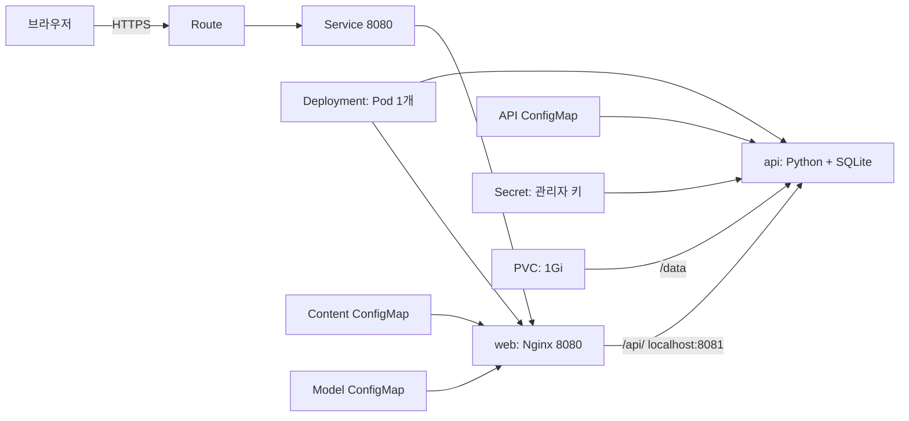
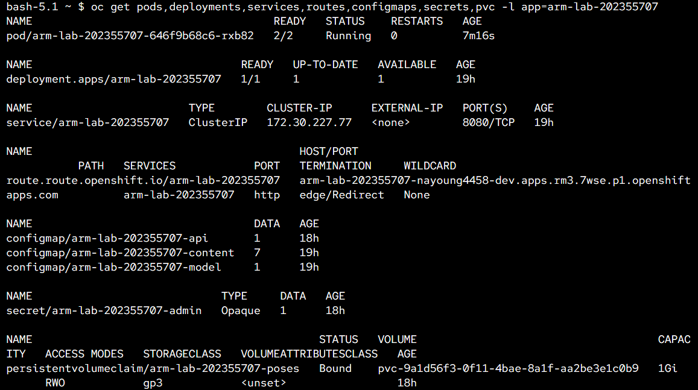
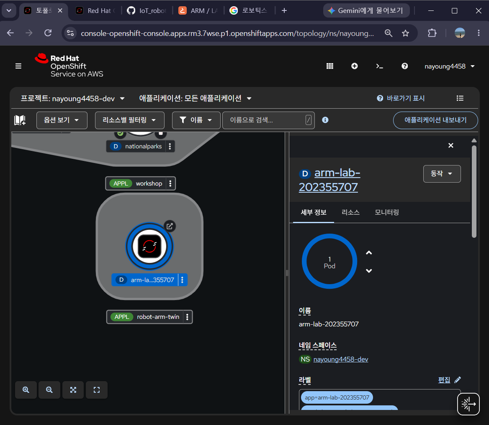
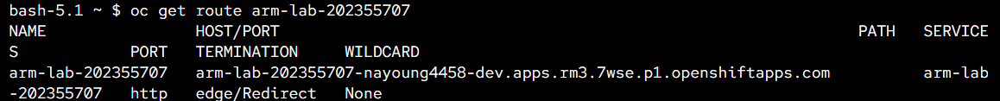
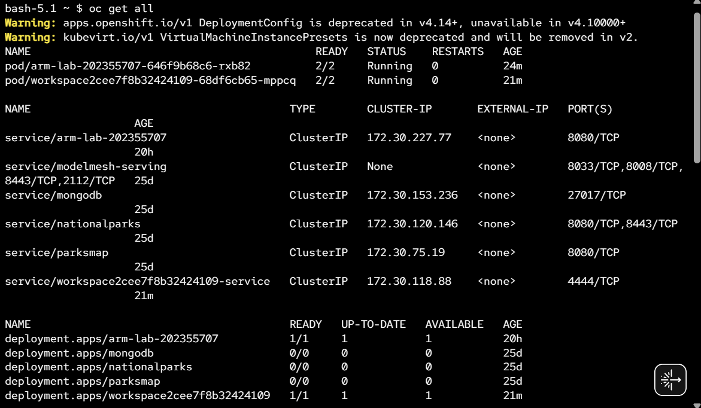
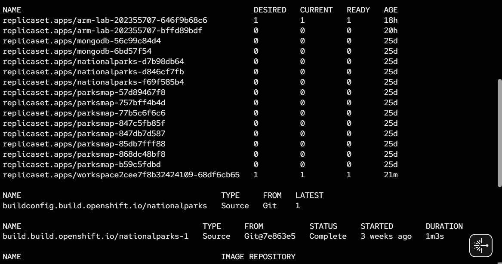
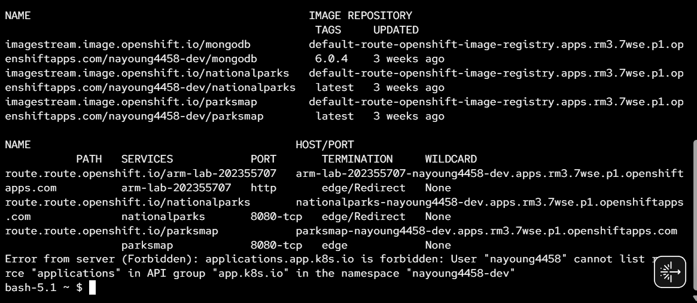
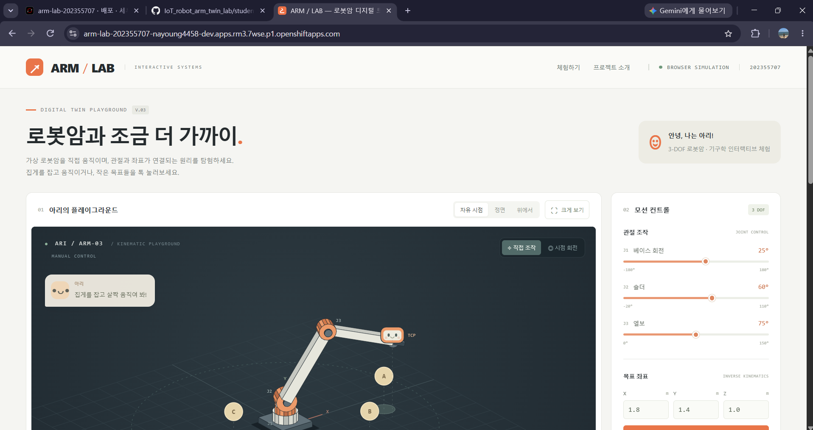

# ARM / LAB - 로봇암 디지털 트윈 체험 웹서비스

**학번 202355707 / 지능형 IoT 플랫폼 / 나만의 컨테이너 만들기**

## 1. 컨테이너 소개

ARM / LAB은 가상 로봇암의 관절과 목표 위치를 직접 조작하며 움직임의 원리를 배우는 웹서비스입니다. 로봇암과 MuJoCo 시뮬레이션에 관심이 있어 이 주제를 골랐습니다. 별도 설치 없이 브라우저에서 기구학을 체험하고 마음에 드는 자세를 보관함에 저장할 수 있습니다.

자체 JavaScript 모델을 사용한 교육용 체험입니다. 실제 로봇이나 센서와 동기화하지 않으며 MuJoCo 물리 엔진, 중력, 관성, 물체 집기나 정밀 충돌 해석은 포함하지 않습니다.

| 기능 | 동작 |
| --- | --- |
| 관절 조작 | J1 베이스, J2 숄더, J3 엘보 각도에 따라 로봇암과 말단 X/Y/Z 좌표 갱신 |
| 목표 이동 | 좌표 입력, 집게 드래그와 바닥 클릭으로 역기구학 해 계산. 불가능한 자세나 경로 안내 |
| 체험 도구 | A, B, C 도전, 자세 프리셋, 반복 데모, 인사, 시점 조작, 궤적과 최근 20초 그래프 |
| 자세 보관함 | 현재 관절 각도와 이름 저장, 목록 조회와 불러오기. 방문자가 공유하는 최대 100개 보관함 |
| 관리자 삭제 | 올바른 관리자 키를 전송한 경우에만 서버에서 자세 삭제 |

### 모델 범위

- Y축이 높이인 3 DOF 모델입니다. 단위는 거리 m, 각도 °입니다.
- 기본 길이는 베이스 0.65 m, 상완 1.8 m, 전완 1.5 m이며 모델 ConfigMap으로 제공합니다.
- J1은 -180°~180°, J2는 -20°~110°, J3는 0°~150°입니다. 엘보와 말단 중심의 바닥 여유 높이는 0.15 m 이상입니다.
- 목표 이동은 smoothstep 보간과 경로의 61개 지점 검사를 사용합니다. 역기구학은 한 가지 굽힘 해를 계산합니다.
- 집게 드래그는 카메라를 향하는 수직 평면을 사용합니다. 바닥 클릭은 X/Z와 입력창의 Y 높이를 사용합니다.
- 집게와 표정은 시각 표현입니다. 목표 완료 기준은 말단과 목표 사이 거리 0.08 m 미만입니다.
- 실시간 조작 상태는 브라우저 메모리에 있고 사용자가 저장한 이름과 관절 각도만 서버 SQLite에 기록합니다. 사용자별 계정이나 보관함 분리는 구현하지 않았습니다.

## 2. 아키텍처와 추가 Object



하나의 Pod에 web과 api 컨테이너를 둡니다. Nginx는 정적 파일을 제공하고 `/api/` 요청을 같은 Pod의 API로 전달합니다. 브라우저가 기구학 계산과 그리기를 담당하고 Python API는 SQLite 저장과 삭제 인증을 담당합니다. Service는 Nginx의 8080 포트만 노출합니다.

| Object 또는 설정 | 이름 | 역할과 확인 방법 |
| --- | --- | --- |
| Deployment | `arm-lab-202355707` | Pod 1개, 컨테이너 2개 유지. 정상 상태 `2/2 Running` |
| Service / Route | `arm-lab-202355707` | app 라벨로 Pod를 선택하고 HTTPS 접속 제공 |
| Content ConfigMap | `arm-lab-202355707-content` | HTML, CSS, JavaScript와 Nginx 설정 주입 |
| Model ConfigMap | `arm-lab-202355707-model` | 링크 길이, 속도와 프리셋 제공. 값 변경 전후 동작 비교 |
| API ConfigMap | `arm-lab-202355707-api` | 표준 라이브러리로 작성한 서버 코드를 읽기 전용으로 마운트 |
| Secret | `arm-lab-202355707-admin` | 관리자 키를 API에만 마운트. 잘못된 키는 HTTP 401, 올바른 키로 삭제하면 HTTP 200 |
| PVC | `arm-lab-202355707-poses` | ReadWriteOnce, 1Gi. `/data/poses.sqlite3` 보관. Pod 교체 후 자세 유지 확인 |
| Probe | 두 컨테이너의 Startup / Readiness / Liveness | 기동, 준비 상태와 생존 상태 검사. 별도 API Object가 아닌 컨테이너 설정 |
| emptyDir | `runtime` | Nginx의 `/tmp` 임시 파일. 영구 저장은 PVC가 담당 |

### 연결과 운영 설정

- Route의 대상과 Service 이름이 같고 Service의 `targetPort: http`는 web의 `containerPort: 8080`과 연결됩니다.
- API는 8081에서 동작하며 Secret은 웹 루트에 노출하지 않습니다. 삭제 요청마다 마운트된 키 파일을 읽습니다.
- web과 api 각각 requests는 CPU 50m / 메모리 64Mi, limits는 CPU 250m / 메모리 128Mi입니다. Pod 합계 requests는 100m / 128Mi, limits는 500m / 256Mi입니다.
- 고정 UID 없이 비루트 실행, 권한 상승 금지, capability 제거, RuntimeDefault seccomp와 읽기 전용 루트를 적용했습니다. PVC 권한은 OpenShift의 SCC와 볼륨 권한 할당에 따릅니다.
- SQLite와 RWO PVC는 단일 Pod로 사용합니다. 업데이트 전략은 `Recreate`이며 기존 Pod 종료 후 새 Pod가 시작되므로 교체 중 짧은 접속 중단이 있습니다.
- 기본 StorageClass를 사용하므로 해당 클러스터에 동적 스토리지와 1Gi 이상의 가용 할당량이 필요합니다.
- 제출 YAML에 namespace, Route host, UID, resourceVersion, status 같은 자동 생성 값은 넣지 않았습니다.

**관리자 키는 과제 재현을 위한 공개 데모 값 `arm-lab-demo-202355707`입니다. 실제 서비스용 비밀 정보가 아닙니다.** 운영 시에는 별도 비공개 키로 Secret을 교체해야 합니다. 저장과 조회는 공개되며 관리자 키는 삭제에만 사용합니다.

## 3. 사용 이미지

| 컨테이너 | 공개 이미지 | 포트 / 실행 |
| --- | --- | --- |
| web | `registry.access.redhat.com/ubi9/nginx-124:1` | 8080 / `nginx -c /etc/arm-lab/nginx.conf -g 'daemon off;'` |
| api | `registry.access.redhat.com/ubi9/python-312:1` | 8081 / `python3 -B /opt/arm-lab/server.py` |

Deployment에 두 이미지의 digest를 고정했습니다. Nginx는 2026-10-23, Python은 2026-10-27 Red Hat 레지스트리에서 manifest digest를 확인했습니다. Python API는 추가 패키지를 설치하지 않습니다. OpenShift에서 두 컨테이너의 실행과 PVC의 Bound 상태를 확인했습니다.

## 4. 저장소 구조와 배포 방법

```text
students/202355707/
├── README.md
├── k8s/                  # 채점용 YAML 8개
│   ├── configmap.yaml
│   ├── model-configmap.yaml
│   ├── api-configmap.yaml
│   ├── deployment.yaml
│   ├── service.yaml
│   ├── route.yaml
│   ├── secret.yaml
│   └── pvc.yaml
├── web/                  # 화면과 모델 설정
├── backend/server.py     # 저장, 조회와 인증 삭제 API
├── tools/                # 생성, 정적 검사, API 테스트와 로컬 실행
└── images/               # 배포 결과와 실행 화면 캡처
```

본인 Sandbox에 로그인하고 `students/202355707`에서 실행합니다. 웹 터미널은 로그인된 계정과 프로젝트를 먼저 확인합니다.

```bash
oc whoami
oc project
oc apply -f k8s/
oc rollout status deployment/arm-lab-202355707 --timeout=300s
oc get pods,deployments,services,routes,configmaps,secrets,pvc -l app=arm-lab-202355707
oc get route arm-lab-202355707 -o jsonpath='{.spec.host}'
```

PVC `Bound`, Pod `2/2 Running`을 확인한 뒤 Route host에 `https://`를 붙여 접속합니다. 예상 화면은 로봇암 체험과 ‘나의 자세 보관함’입니다. 관절 조작, 데모, 자세 저장과 불러오기를 확인합니다. `/healthz`는 HTTP 200과 `ok`, `/api/health`는 HTTP 200과 `{"status":"ok"}`, `/api/poses`는 `{"poses":[...]}`를 반환합니다.

웹 파일과 API 코드가 ConfigMap에 포함되어 있어 다른 사람도 이미지 빌드나 원본 복사 없이 YAML만으로 배포할 수 있습니다.

### 원본 수정과 로컬 검사

```bash
python tools/sync-configmap.py
python tools/verify-manifests.py
python tools/test-api.py
python tools/run-local.py
```

로컬 통합 화면은 <http://127.0.0.1:8765>입니다. SQLite와 데모 키는 Git에서 제외한 `.local/`에 저장됩니다. 로컬 테스트는 Kubernetes PVC 자체를 검증하는 것이 아닙니다. 수정 후 생성된 YAML과 원본을 함께 Commit하고 `oc apply -f k8s/`로 반영합니다.

### 삭제 후 YAML만으로 재배포

**아래 명령은 PVC도 삭제하므로 저장한 자세가 사라질 수 있습니다.** 데이터 유지 시험에서는 PVC를 남겨두고 Pod만 교체합니다. 전체 삭제 시험은 과제 재현성 확인용으로 따로 수행합니다.

```bash
oc delete -f k8s/ --wait=true
oc apply -f k8s/
oc rollout status deployment/arm-lab-202355707 --timeout=300s
oc get pods,deployments,services,routes,configmaps,secrets,pvc -l app=arm-lab-202355707
oc get route arm-lab-202355707
```

새로 조회한 Route에 접속하여 저장, 불러오기, 관리자 삭제와 기존 데모를 확인합니다. `oc get all`이 Sandbox의 다른 API 조회 권한 때문에 Forbidden을 반환하면 위처럼 리소스 종류를 명시합니다.

## 5. 배포 결과와 검증

- **확인 일시:** 2026-10-28 10:26~10:42 (Asia/Seoul)
- **환경:** Red Hat Developer Sandbox / OpenShift, 프로젝트 `nayoung4458-dev`
- **접속 주소:** [ARM / LAB 웹서비스](https://arm-lab-202355707-nayoung4458-dev.apps.rm3.7wse.p1.openshiftapps.com)

리소스 조회에서 Pod `arm-lab-202355707-646f9b68c6-rxb82`의 **2/2 Running, 재시작 0회**, Deployment의 **1/1** 상태를 확인했습니다. ConfigMap 3개와 Secret이 존재하며 PVC `arm-lab-202355707-poses`는 **Bound, 1Gi, RWO, StorageClass gp3**로 표시됐습니다. 실제 Route 주소에서 로봇암 체험 화면이 표시되는 것도 확인했습니다.





### Route 연결

`oc get route arm-lab-202355707` 출력에서 과제 Service로 연결되는 Route와 `edge/Redirect` 설정을 확인했습니다.



<details>
<summary>oc get all 출력</summary>

아래 3장은 프로젝트 전체의 `oc get all` 출력을 순서대로 캡처한 것입니다. 과제 외 실습 리소스도 함께 표시됩니다. 로봇암 서비스의 Pod는 `2/2 Running`, Deployment는 `1/1`이며 현재 ReplicaSet의 준비된 Pod 수는 1개입니다.







마지막 `applications.app.k8s.io`의 Forbidden은 해당 API의 리소스 목록을 조회할 권한이 없어 발생했습니다. 과제 리소스의 상태는 위 `resources.png`처럼 종류와 app 라벨을 지정한 조회 결과로 확인했습니다. 출력에 보이는 이전 ReplicaSet이나 실습용 Deployment의 0개 표시는 현재 과제 Pod의 실행 상태와 구분합니다.

</details>

| 검증 항목 | 확인 결과 |
| --- | --- |
| OpenShift 배포 | 컨테이너 2개 Running, Deployment 1/1, PVC Bound 확인 |
| YAML 정적 검사 | 리소스 8개, 참조, 자원과 보안 설정, ConfigMap 체크섬 검사 통과 |
| 저장과 인증 API | 로컬 HTTP 테스트에서 저장, 조회, 인증 거부와 성공, 키 교체 확인 |
| 브라우저 기능 | 로컬 Chrome에서 자세 저장, 불러오기, 인증 삭제와 모바일 레이아웃 확인 |
| 저장 데이터 유지 | 로컬 API 재시작 후 동일한 자세 조회 확인. 실제 Pod 교체 전후 비교는 별도 확인 필요 |
| 전체 삭제 후 재배포 | 현재 구성의 YAML 8개로 전체 삭제 및 재배포 확인 필요 |

### 실제 웹사이트 접속 화면



주소창과 로봇암 체험 화면이 함께 보이는 실제 배포 캡처입니다. 자세 보관함의 저장과 불러오기, Secret 인증과 Pod 교체 후 데이터 유지 결과는 별도로 확인합니다.

### 추가 Object 확인 방법

**ConfigMap:** `web/config.js`의 `speedDegreesPerSecond`를 45에서 20으로 바꾸고 생성기와 정적 검사 후 적용합니다. 같은 초기 자세에서 같은 프리셋으로 이동하는 시간을 비교합니다. 확인 후 값을 45로 복원하고 다시 생성, 적용합니다. 짧은 이동에는 최소 애니메이션 시간이 있으므로 ‘옮기기’처럼 큰 각도 변화를 사용합니다.

**Secret:** 보관함에 자세를 저장하고 ‘관리자 삭제’에 잘못된 키를 넣어 삭제합니다. 오류와 자세 유지를 확인한 뒤 공개 데모 키 `arm-lab-demo-202355707`로 다시 삭제합니다. 예상 결과는 인증 실패 HTTP 401, 삭제 성공 HTTP 200입니다.

**PVC:** ‘PVC 유지 확인’ 자세를 저장하고 이름과 관절 각도를 기록합니다. PVC를 유지한 채 다음 명령으로 Pod만 교체합니다.

```bash
oc rollout restart deployment/arm-lab-202355707
oc rollout status deployment/arm-lab-202355707 --timeout=300s
oc get pods,pvc -l app=arm-lab-202355707
```

새 Pod가 `2/2 Running`이 되면 브라우저에서 보관함을 새로고침합니다. 같은 자세가 남아 있고 불러오기가 동작하는지 확인합니다. 전체 리소스 삭제 시험과 달리 이 단계에서는 PVC를 삭제하지 않습니다.

배포 리소스 목록, `oc get all` 출력, Route와 Topology, 실제 웹사이트 접속 화면은 `images/`에 저장했습니다. 위 캡처는 리소스 상태와 웹페이지 표시를 증빙하며 인증 동작이나 저장 데이터 유지 시험 결과를 대신하지 않습니다.

Sandbox 정책으로 Pod가 0개로 축소되면 다음 명령으로 다시 실행하고 준비 상태를 확인합니다.

```bash
oc scale deployment/arm-lab-202355707 --replicas=1
oc rollout status deployment/arm-lab-202355707 --timeout=300s
```

## 6. 설계 과정과 해결 방법

| 문제 | 적용한 방법 | 검증 |
| --- | --- | --- |
| 새 Pod에서 저장한 자세를 다시 읽어야 함 | SQLite 파일을 PVC의 /data에 저장 | 로컬 API 재시작 통과, 실제 Pod 교체 시험 필요 |
| 공개 저장 기능과 관리자 삭제 구분 | Secret 파일과 Bearer 인증, hmac.compare_digest로 키 비교 | 인증 실패와 성공, 키 교체 로컬 통과 |
| RWO 볼륨을 사용하는 Pod 업데이트 | replicas 1 및 Recreate | OpenShift 적용 후 Pod 2/2 Running 확인 |
| YAML만으로 코드까지 재현 | ConfigMap 3개에 모든 소스 포함, 체크섬으로 Pod 교체 | 정적 참조 검사 통과 |
| 기존 로봇암 체험과 저장 UI 연결 | 현재 각도 복사, 불러올 때 기존 경로 검사 사용 | 기존 바닥 및 관절 범위 검사를 유지 |

## 7. AI 및 참고자료 활용 내역

- **OpenAI Codex:** 주제 구체화, 웹 UI, 기구학 코드, YAML, 문서 초안 작성과 로컬 검증에 활용했습니다.
- **과제 안내 PDF:** README 필수 항목, 학번 폴더, YAML 재배포 및 채점 기준을 참고했습니다.
- **4-1, 4-2, 5-2 강의:** Deployment, Service와 Route 연결, OpenShift 배포, 자원 제한, Probe, ConfigMap을 참고했습니다.
- [Red Hat UBI Nginx 이미지](https://catalog.redhat.com/en/software/containers/ubi9/nginx-124/657b066b6c1bc124a1d7ff39) / [이미지 공식 사용 설명](https://github.com/sclorg/nginx-container/blob/master/1.24/README.md)
- [OpenShift 비루트 실행](https://developers.redhat.com/blog/2020/10/26/adapting-docker-and-kubernetes-containers-to-run-on-red-hat-openshift-container-platform)
- [Kubernetes projected volume](https://kubernetes.io/docs/concepts/storage/projected-volumes/) / [Probe](https://kubernetes.io/docs/tasks/configure-pod-container/configure-liveness-readiness-startup-probes/) / [Deployment 업데이트](https://kubernetes.io/docs/concepts/workloads/controllers/deployment/) / [이미지 digest](https://kubernetes.io/docs/concepts/containers/images/)
- [Microduck Sandbox](https://huggingface.co/spaces/pollen-robotics/microduck-simulator): 직접 조작하는 로봇 체험 방향을 참고했습니다. 원본 코드, 모델, 학습 정책, 미디어는 사용하지 않았습니다.

- [Red Hat UBI Python 3.12](https://catalog.redhat.com/software/containers/ubi9/python-312/657b08d023df896ebfacf402)
- [Kubernetes Secret](https://kubernetes.io/docs/concepts/configuration/secret/), [PersistentVolumeClaim](https://kubernetes.io/docs/concepts/storage/persistent-volumes/)

## 8. 오류 확인

```bash
oc describe deployment arm-lab-202355707
oc describe pvc arm-lab-202355707-poses
oc logs deployment/arm-lab-202355707 -c web --tail=100
oc logs deployment/arm-lab-202355707 -c api --tail=100
oc get events --sort-by=.metadata.creationTimestamp
```

PVC가 Pending이면 기본 StorageClass와 스토리지 할당량, 이벤트를 확인합니다. ImagePullBackOff는 이미지 주소와 레지스트리 접근을, API 실행 오류는 PVC 쓰기 권한과 Secret 마운트를 확인합니다. `oc get all`의 다른 API 조회 권한 오류는 과제 리소스 종류를 명시한 조회 명령으로 확인합니다.

제출 기한: **2026-10-30 10:00 (Asia/Seoul)**.
