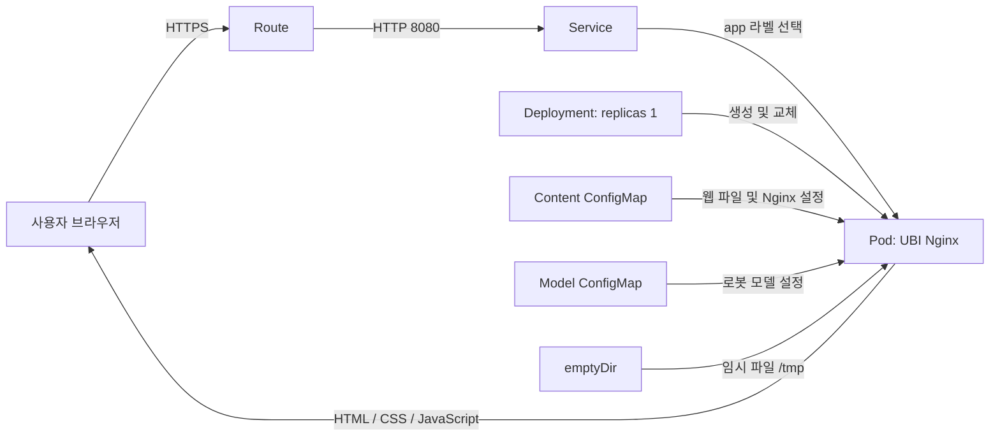
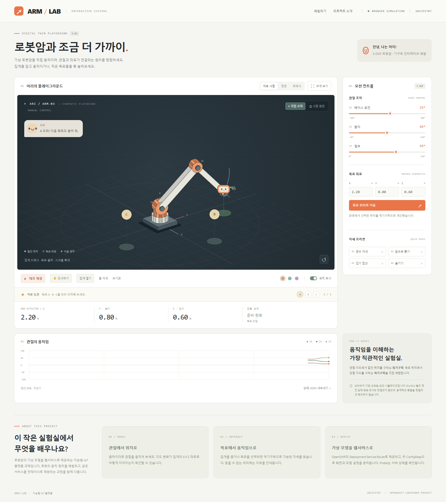

# ARM / LAB - 로봇암 디지털 트윈 체험 웹서비스

**학번 202355707 · 지능형 IoT 플랫폼 · 나만의 컨테이너 만들기**

> 초기 버전의 Sandbox HTTPS 접속·데모 동작을 확인했습니다. 최신 플레이그라운드는 로컬 기능 검증을 완료했으며, 최신 YAML 재적용·삭제 후 재배포·실제 캡처 등록은 추가 확인이 필요합니다. 이 문서에서는 로컬 점검과 Sandbox 검증을 구분합니다.

## 1. 컨테이너 소개

**ARM / LAB은 가상 로봇암의 관절과 목표 위치를 직접 조작하며 움직임의 원리를 배우는 웹서비스입니다.** 로봇암·MuJoCo 시뮬레이션에 대한 관심에서 출발해, 별도 설치 없이 로봇의 가상 모델을 탐색할 수 있는 체험 공간을 주제로 선정했습니다.

이 프로젝트에서 디지털 트윈 체험은 가상 모델의 상태를 조작하고 시각화하는 교육용 활동을 의미합니다. 실제 장비·센서와의 동기화나 MuJoCo 물리 엔진은 포함하지 않으며, 자체 JavaScript 기구학 모델을 사용합니다.

### 주요 기능

| 체험 | 동작과 확인할 결과 |
| --- | --- |
| 관절 조작 | J1 베이스·J2 숄더·J3 엘보 각도를 바꾸면 로봇암과 말단 X/Y/Z 좌표가 갱신됩니다. |
| 목표 위치 이동 | 좌표 입력·집게 드래그·바닥 클릭으로 역기구학 해를 구합니다. 도달할 수 없는 위치는 안내합니다. |
| 작은 도전 | A·B·C 목표를 선택하고 말단이 도착하면 완료 상태가 표시됩니다. |
| 동작 관찰 | 자세 프리셋, 반복 데모, 인사 동작, 이동 궤적과 최근 20초 관절 그래프를 제공합니다. |
| 화면·상태 조작 | 시점 회전·확대·크게 보기, 색상 변경, 집게 열기·닫기 표현, 상태 JSON 다운로드를 지원합니다. |

### 모델 범위와 한계

- Y축이 높이인 3 DOF 모델입니다. 단위는 거리 m, 각도 °입니다.
- 기본 길이는 베이스 0.65 m, 상완 1.8 m, 전완 1.5 m이며 모델 ConfigMap으로 제공합니다.
- 관절 범위는 J1 -180~180°, J2 -20~110°, J3 0~150°입니다. 엘보·말단 중심의 바닥 여유 높이는 0.15 m 이상입니다.
- 목표 자세로 이동할 때 관절 공간의 smoothstep 보간과 61개 지점의 경로 표본 검사를 사용합니다. 역기구학은 한 가지 굽힘 해만 계산합니다.
- 집게 드래그는 카메라를 향하는 수직 평면에서 목표를 계산합니다. 바닥 클릭은 선택한 X/Z와 입력창의 Y 높이를 사용합니다.
- 물체 집기·중력·관성·접촉력·정밀 충돌을 해석하지 않습니다. 집게 열기·표정은 시각 표현이며, 목표 완료는 말단과 목표의 거리 0.08 m 미만으로 판정합니다.
- 상태는 브라우저 메모리에 유지됩니다. 서버 DB·영구 저장·다중 사용자 상태 공유는 포함하지 않습니다.

## 2. 아키텍처와 Object 역할



컨테이너는 정적 파일을 전달하며, 로봇암 계산·그리기·조작 상태 관리는 사용자 브라우저가 담당합니다. 따라서 웹서버 Pod 하나로 구성했습니다.

| 리소스·설정 | 이름 또는 위치 | 역할 |
| --- | --- | --- |
| Deployment | `arm-lab-202355707` | Pod 1개 유지, 이미지·설정·Probe·자원 선언, 롤링 업데이트 |
| Service | `arm-lab-202355707` | Pod IP 변경과 관계없이 `app` 라벨로 웹서버 연결 |
| Route | `arm-lab-202355707` | 외부 HTTPS 제공, edge TLS 종료와 HTTP→HTTPS 전환 |
| Content ConfigMap | `arm-lab-202355707-content` | HTML·CSS·앱 JavaScript·Nginx 설정을 공개 이미지에 주입 |
| Model ConfigMap | `arm-lab-202355707-model` | 링크 길이·속도·프리셋·이름·기본 색상을 별도 제공 |
| Startup Probe | `/healthz`, 2초 간격, 실패 기준 30회 | 기동을 기다린 뒤 나머지 상태 검사를 시작 |
| Readiness Probe | `/index.html`, 5초 간격 | 웹페이지 제공 준비가 된 Pod에 트래픽 전달 |
| Liveness Probe | `/healthz`, 10초 간격 | 연속 3회 실패 시 컨테이너 재시작 |
| emptyDir | `/tmp`, 최대 32Mi | 읽기 전용 루트 환경에서 PID와 임시 파일 저장 |

Probe와 emptyDir는 별도 API Object가 아니라 Pod 내부 설정입니다. 두 ConfigMap은 **projected volume**으로 같은 웹 루트에 합쳐집니다. 데이터베이스나 인증 기능이 없어 PVC·Secret은 사용하지 않았습니다.

### 연결·자원·보안 설계

- `Route.spec.to.name` → Service 이름, Route의 `targetPort: http` → Service의 `name: http`로 연결됩니다.
- Service의 `selector.app` → Pod의 `labels.app`, Service의 `targetPort: http` → 컨테이너의 `name: http / containerPort: 8080`으로 연결됩니다.
- requests는 CPU **50m / 메모리 64Mi**, limits는 CPU **250m / 메모리 128Mi**입니다.
- `maxSurge: 1`, `maxUnavailable: 0`으로 새 Pod가 준비된 후 기존 Pod를 교체합니다. 업데이트 중 최대 2개 Pod의 자원이 필요합니다.
- 비루트·임의 UID 실행을 고려하여 고정 UID를 지정하지 않았습니다. 권한 상승 금지, capability 제거, RuntimeDefault seccomp, 읽기 전용 루트 파일시스템을 적용했습니다.
- `namespace`, Route `host`, Service `clusterIP`, `status`, `uid` 등은 제출 YAML에 고정하지 않았습니다.

## 3. 사용 이미지

| 항목 | 값 |
| --- | --- |
| 공개 이미지 | `registry.access.redhat.com/ubi9/nginx-124:1` |
| 배포 시 버전 고정 | `sha256:f414eb6c23a501c921542b75e30032979640682d8eaa37b500d7d34f4048e5ec` |
| 컨테이너 포트 | `8080/TCP` |
| 실행 명령 | `nginx -c /etc/arm-lab/nginx.conf -g 'daemon off;'` |
| 웹 루트 | `/opt/app-root/src` |

Red Hat UBI 기반 공개 이미지로 정적 웹서비스를 제공하고, 비루트·8080 실행 방식으로 OpenShift 환경에 맞췄습니다. Deployment에는 `:1@sha256:...` 형식으로 digest를 고정하여 태그 변경에 따른 재현성 차이를 줄였습니다. 해당 digest는 2026-10-23 레지스트리 HTTP 200과 linux/amd64·arm64·s390x·ppc64le 목록을 확인했습니다. 최신 고정 이미지 구성의 Sandbox 실행 결과는 별도 검증해야 합니다.

## 4. 저장소 구조와 배포 방법

```text
students/202355707/
├── README.md
├── k8s/                    # 채점자가 그대로 적용하는 YAML 5개
│   ├── configmap.yaml
│   ├── model-configmap.yaml
│   ├── deployment.yaml
│   ├── service.yaml
│   └── route.yaml
├── web/                    # 웹 파일과 모델 설정 원본
├── tools/                  # 생성 및 로컬 정적 점검
├── docs/verification.md    # 설정 변경·증빙·오류 확인 절차
└── images/                 # 실제 배포 캡처와 로컬 미리보기
```

### Sandbox 배포

본인 Developer Sandbox에 `oc login`한 뒤 본인 프로젝트인지 확인합니다. 아래 명령의 실행 위치는 **`students/202355707`**입니다.

```bash
oc project
oc apply -f k8s/
oc rollout status deployment/arm-lab-202355707 --timeout=180s
oc get pods -l app=arm-lab-202355707
oc get all -l app=arm-lab-202355707
oc get route arm-lab-202355707
```

출력된 Route host에 `https://`를 붙여 접속합니다. **Pod Running / READY 1/1**, ARM / LAB의 V.02 표시, 관절 조작·목표 이동·데모 동작을 확인합니다. `/healthz`의 예상 응답은 HTTP 200과 `ok`입니다.

채점에 필요한 웹 파일은 ConfigMap에 포함되어 있습니다. 다른 사람이 배포할 때 `web/` 복사·이미지 빌드·생성 스크립트 실행은 필요하지 않습니다.

### 삭제 후 재배포 - 필수 확인

아래 명령은 이 과제 YAML이 선언한 리소스만 삭제합니다. 학번 폴더와 현재 프로젝트를 확인하고 실행합니다.

```bash
oc delete -f k8s/ --wait=true
oc apply -f k8s/
oc rollout status deployment/arm-lab-202355707 --timeout=180s
oc get pods -l app=arm-lab-202355707
oc get route arm-lab-202355707
```

다시 조회한 Route 주소에서 정상 동작을 확인합니다. 클러스터가 host를 할당하므로 이전 주소가 유지된다고 가정하지 않습니다.

### 원본 수정 후 업데이트

```bash
python tools/sync-configmap.py
python tools/verify-manifests.py
oc apply -f k8s/
oc rollout status deployment/arm-lab-202355707 --timeout=180s
```

생성기는 두 ConfigMap과 Deployment의 `checksum/content`, `checksum/model`을 함께 갱신합니다. 내용이 변경되면 Pod 템플릿의 체크섬이 달라져 `oc apply` 시 롤링 업데이트가 발생합니다. 같은 입력으로 다시 생성하면 결과도 같습니다. 변경된 YAML 3개도 함께 Commit합니다.

웹 콘솔에서 ConfigMap만 직접 편집하면 체크섬이 자동 갱신되지 않으므로 Deployment의 롤아웃 재시작이 필요합니다. 제출 전에는 원본과 YAML을 다시 동기화합니다. 자세한 콘솔 절차와 설정 변경 실험은 [검증 가이드](docs/verification.md)에 정리했습니다.

로컬 화면은 저장소 루트에서 `python -m http.server 8765 --bind 127.0.0.1 --directory students/202355707/web`로 실행하고 <http://127.0.0.1:8765>에서 확인할 수 있습니다.

## 5. 배포 결과와 검증 증빙

| 검증 항목 | 현재 확인 상태 | 증빙 |
| --- | --- | --- |
| 초기 버전 리소스 생성 | 콘솔에서 5개 리소스 생성 성공 화면 확인 | 채팅으로 확인, 저장소 캡처 등록 필요 |
| 초기 버전 HTTPS·데모 | 실제 접속과 데모 동작 확인 | 브라우저 캡처 등록 필요 |
| 최신 V.02 로컬 기능 | 관절·IK·드래그·바닥 클릭·미션·인사·재생·JSON 확인 | 자동 브라우저 점검, 아래 로컬 미리보기 |
| 최신 V.02 반응형 | 폭 1600/900/390px에서 가로 넘침·JS 예외 없음 | 자동 브라우저 점검 |
| 최신 YAML 정적 점검 | 리소스 연결·포트·자원·보안·파일·체크섬 검사 통과 | `python tools/verify-manifests.py` |
| 최신 Sandbox / READY 1/1 | 추가 확인 필요 | `images/topology.png` 등록 필요 |
| 최신 실제 HTTPS 화면 | 추가 확인 필요 | `images/sandbox-browser.png` 등록 필요 |
| 삭제 후 재배포 | 추가 확인 필요 | `images/redeploy.png` 등록 필요 |
| 모델 설정 변경·Probe | 추가 확인 필요 | [검증 가이드](docs/verification.md)의 비교·캡처 절차 |

실제 배포 후에는 위 상태를 실제 결과로 갱신하고 검증 일시·Route URL과 함께 캡처를 본문에 삽입합니다. 아직 없는 이미지를 배포 성공 증빙으로 표시하지 않았습니다.

<details>
<summary>로컬 화면 미리보기 - Sandbox 배포 증빙과 구분</summary>



</details>

## 6. 설계 과정과 해결한 문제

| 문제·고려 사항 | 적용한 해결 | 확인 범위 |
| --- | --- | --- |
| 별도 로봇 프로젝트·센서가 없는 환경 | 자체 기구학 모델과 직접 조작 UI 구성, 구현 범위 명시 | 로컬 기능 검증 |
| YAML만으로 웹페이지 재현 필요 | 모든 웹 파일과 모델 설정을 ConfigMap에 포함 | 원본·포함 파일·마운트 경로 정적 비교 |
| 설정 변경 후 기존 Pod가 유지될 수 있음 | 생성된 ConfigMap의 해시를 Pod 템플릿에 반영 | 해시 변경과 생성 반복의 동일성 검사 |
| 비루트 웹서버의 포트·쓰기 권한 | 8080, 읽기 전용 파일, /tmp emptyDir 사용 | 구성 점검, 최신 Sandbox 재검증 필요 |
| 도달 불가능한 목표·바닥 아래 자세 | 관절 제한·역기구학·바닥 여유 높이 검사와 화면 안내 | 도달·거부 사례 로컬 검증 |

위 항목은 구현·설계 과정이며, 실제 Sandbox에서 발생한 오류를 재현했다고 주장하는 기록은 아닙니다. 배포 중 오류가 발생하면 메시지·원인·수정과 재확인 결과를 추가합니다.

## 7. AI·참고자료 활용 내역

- **OpenAI Codex:** 주제 구체화, 웹 UI·기구학 코드·YAML·문서 초안 작성과 로컬 검증에 활용했습니다. 제출자는 코드·YAML의 역할을 이해하고 본인 Sandbox에서 실행 결과를 확인합니다.
- **과제 안내 PDF:** README 필수 항목, 학번 폴더, YAML 재배포 및 채점 기준을 참고했습니다.
- **4-1·4-2·5-2 강의:** Deployment·Service·Route 연결, OpenShift 배포, 자원 제한·Probe·ConfigMap을 참고했습니다.
- [Red Hat UBI Nginx 이미지](https://catalog.redhat.com/en/software/containers/ubi9/nginx-124/657b066b6c1bc124a1d7ff39) · [이미지 공식 사용 설명](https://github.com/sclorg/nginx-container/blob/master/1.24/README.md)
- [OpenShift 비루트 실행](https://developers.redhat.com/blog/2020/10/26/adapting-docker-and-kubernetes-containers-to-run-on-red-hat-openshift-container-platform)
- [Kubernetes projected volume](https://kubernetes.io/docs/concepts/storage/projected-volumes/) · [Probe](https://kubernetes.io/docs/tasks/configure-pod-container/configure-liveness-readiness-startup-probes/) · [Deployment 업데이트](https://kubernetes.io/docs/concepts/workloads/controllers/deployment/) · [이미지 digest](https://kubernetes.io/docs/concepts/containers/images/)
- [Microduck Sandbox](https://huggingface.co/spaces/pollen-robotics/microduck-simulator): 직접 조작하는 로봇 체험 방향을 참고했습니다. 원본 코드·모델·학습 정책·미디어는 사용하지 않았습니다.

## 8. 채점 기준 대응과 제출 체크리스트

| 평가 항목 | 배점 | 이 프로젝트의 대응 |
| --- | ---: | --- |
| 배포 성공 | 40 | `k8s/`만으로 배포, Running·HTTPS 접속·삭제 후 재배포 검증 |
| 소개·아키텍처 문서 | 25 | 목적·기능·구성도·Object 역할·이미지·방법·실제 결과·AI 활용 내역 |
| YAML 품질 | 20 | 이름·라벨·포트·참조 일치, resources, 자동 생성 필드 제외, 이미지 고정·체크섬 점검 |
| 추가 Object 활용 | 15 | Content/Model ConfigMap의 실제 파일 주입과 설정 변경, 시작·준비·생존 Probe 설명 및 확인 |

추가 활용은 총 100점 중 15점이며 종류별 배점·필수 개수는 안내에 명시되지 않았습니다. Object 역할과 실제 작동 결과를 설명합니다.

- [x] 본인 학번 폴더와 YAML 5개 구성
- [x] README 필수 항목, 원본과 생성 YAML, AI 활용 내역 정리
- [x] 로컬 웹 기능과 YAML 정적 연결 검사
- [ ] 최신 YAML로 본인 Sandbox 배포, Pod Running / READY 1/1 확인
- [ ] 실제 HTTPS 화면·Topology 캡처 등록 및 본문 삽입
- [ ] ConfigMap 설정 변경·Probe 확인 결과 기록
- [ ] 삭제 후 YAML만으로 재배포 및 접속 확인
- [ ] 모든 YAML 항목을 본인이 설명할 수 있는지 점검
- [ ] GitHub Commit·Push 후 저장소 URL 제출

제출 기한: **2026-10-30 10:00 (Asia/Seoul)**.
